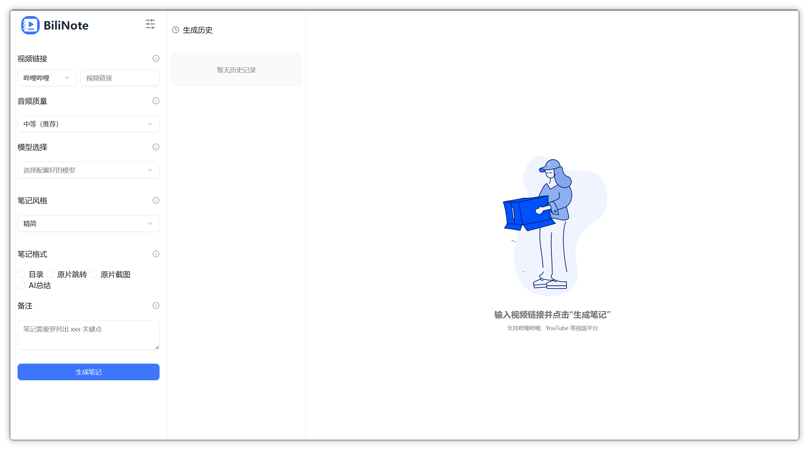
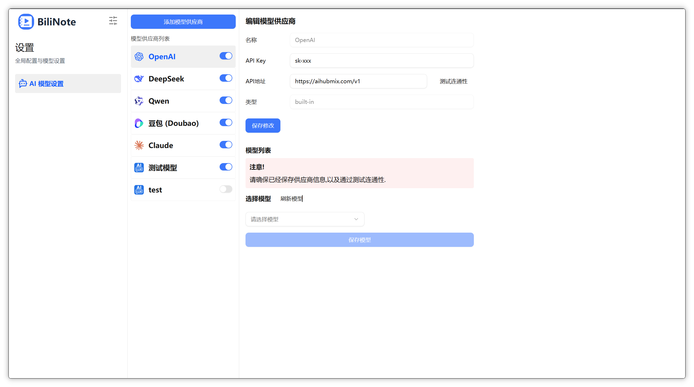
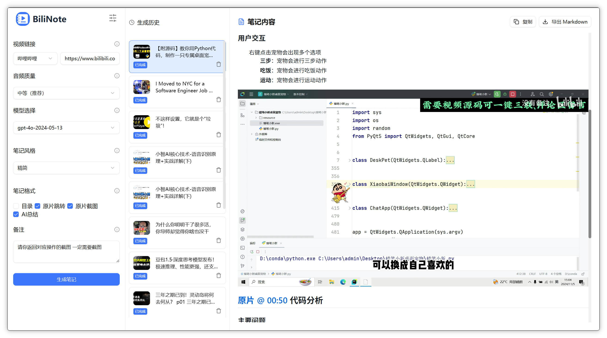
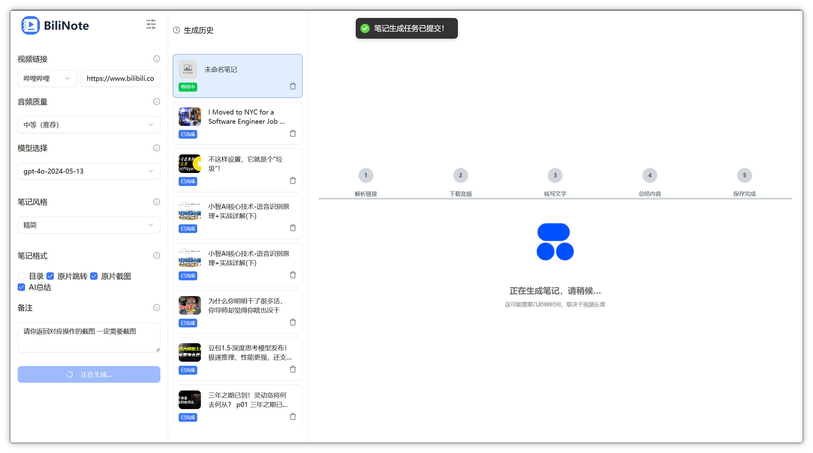
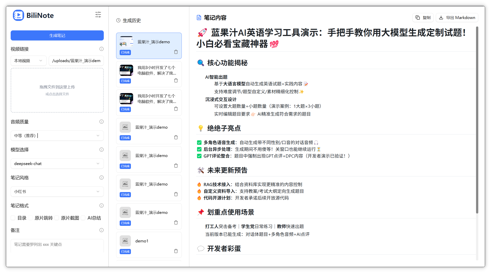

<div align="center">
  
  <h1>VidInsight</h1>
  <p><i>AI 视频笔记生成 + Agent 知识库问答，让 AI 真正理解你的视频</i></p>

  <p>
    
    
    
    
    
    
  </p>
</div>

## 在线试用

**网页版**：http://54.201.112.20 （仅限试用）

> ⚠️ 网页端当前限制：
> - 仅支持 B 站链接（YouTube 部分支持）
> - 转写为 CPU 模式（有字幕时直接拉取，速度不受影响）
> - 小红书收藏捕获需桌面端（依赖本地浏览器登录态）
> - 需自行配置 LLM API Key（设置 → LLM 供应商）
> - 服务器在美国，国内访问可能较慢


---

> **VidInsight 基于 [VidInsight](https://github.com/JefferyHcool/VidInsight) v2.4.0 二次开发**，在原有视频笔记生成能力之上，新增了自主设计的 **VidInsightAgent ReAct Agent 系统**，支持跨视频知识库的 AI 深度问答（BM25 + Function Calling），并配套浏览器插件实现一站式视频学习工作流。

## ✨ 核心特性

### 继承自 VidInsight

- **多平台支持**：Bilibili、YouTube、抖音、快手、本地视频
- **AI 笔记生成**：LLM 自动提取视频内容，生成结构化 Markdown 笔记
- **多模态理解**：支持视频截图 + 音频转写融合理解
- **灵活配置**：自行配置 LLM 供应商（OpenAI / DeepSeek / Qwen 等）和转写引擎（Fast-Whisper / MLX-Whisper / Groq / BCut 等）
- **桌面客户端**：Windows + macOS Tauri 桌面应用
- **笔记历史管理**：多版本记录保留，任务历史回看

### VidInsight 新增

- **🧠 VidInsightAgent ReAct Agent**：自主设计的 Agent 系统，非 LangChain/LlamaIndex 等第三方框架，基于 OpenAI Function Calling 协议实现 Thought-Action-Observation 循环
- **🔍 跨视频知识库问答 (RAG)**：对已生成的所有笔记进行统一索引（BM25 + 可选向量搜索 + 可选 BGE Reranker），Agent 自动调用 `search_kb` / `get_source` / `list_notes` 工具在知识库中检索
- **⚡ 浏览器插件（MV3）**：Chrome / Edge / Firefox，支持 popup 一键生成、视频页悬浮按钮、右键菜单、侧边栏 AI 问答、Cookie 同步
- **🎯 意图分类 + 工具调用**：Agent 自动判断用户输入属于 `search` / `task` / `chitchat`，按需进入 ReAct 循环，闲聊类直接回复
- **🛡️ Agent 安全层**：入口输入消毒（22 组 Prompt 注入正则过滤 + 长度截断），System Prompt 内置隐私保护与内容安全约束，来源引用反幻觉
- **📚 来源追溯**：AI 回答附带精确来源引用（视频标题、章节、时间戳、来源类型）

## 🏗️ 项目架构

```
VidInsight/
├── backend/                  # FastAPI 后端
│   └── app/
│       ├── services/
│       │   ├── agent.py           # VidInsightAgent ReAct Agent 核心
│       │   ├── agent_tools.py     # Agent 工具定义 (search_kb, get_source, list_notes, clarify)
│       │   ├── knowledge_base.py  # 统一知识库 (BM25 + 可选向量搜索 + Reranker)
│       │   ├── chat_service.py    # RAG 问答入口 + Agent 缓存
│       │   └── note.py            # 笔记生成流水线
│       ├── downloaders/      # 平台适配器 (bilibili, youtube, douyin, kuaishou, local)
│       ├── transcriber/      # 语音转写引擎 (fast-whisper, groq, bcut, kuaishou, mlx-whisper)
│       ├── gpt/              # LLM 集成 (工厂模式 + prompt 模板)
│       └── db/               # SQLite + SQLAlchemy
├── vidinsight-frontend/        # React 19 + Vite + TypeScript 前端
├── vidinsight-extension/       # Vue 3 + Vite 浏览器插件 (MV3)
└── docker-compose.yml        # Docker 部署编排
```

### Agent 工作流

```
用户提问 → 意图分类 (search / task / chitchat)
              ↓
    search/task → 知识库预检索 (BM25)
              ↓
    ReAct Loop (≤5 轮):
      LLM 思考 → 选择工具 → 执行 (search_kb / get_source / list_notes / clarify)
              ↓
    最终回答 + 来源引用
```

## 📸 截图预览







## 🚀 快速开始

### 方式一：Docker 部署（推荐）

```bash
git clone https://github.com/JefferyHcool/VidInsight.git
cd VidInsight
cp .env.example .env

# 标准部署
docker-compose up --build -d

# GPU 加速（需 NVIDIA GPU + NVIDIA Container Toolkit）
docker-compose -f docker-compose.gpu.yml up --build -d
```

访问：`http://localhost`

### 方式二：源码部署

#### 1. 后端

```bash
cd backend
pip install -r requirements.txt
python main.py    # 启动在 0.0.0.0:8483
```

#### 2. 前端

```bash
cd vidinsight-frontend
pnpm install
pnpm dev          # 启动在 localhost:3015，自动代理 /api → 后端
```

访问：`http://localhost:3015`

### 浏览器插件

```bash
cd vidinsight-extension
pnpm install
pnpm build        # 构建到 extension/ 目录
```

Chrome 加载路径：`chrome://extensions/` → 「加载已解压的扩展程序」→ 选择 `vidinsight-extension/extension/` 目录。

## ⚙️ 依赖

### FFmpeg（必需）

```bash
# Mac
brew install ffmpeg

# Ubuntu / Debian
sudo apt install ffmpeg

# Windows — 从 https://ffmpeg.org/download.html 下载，加入 PATH
```

Docker 部署已内置 FFmpeg。

### CUDA / GPU 加速（可选）

Faster Whisper 转写支持 NVIDIA GPU 加速。后端自动检测 CUDA 可用性，可用就走 GPU，否则回退 CPU。

**前提**：NVIDIA 显卡 + 驱动 (CUDA ≥ 12.4) + [NVIDIA Container Toolkit](https://docs.nvidia.com/datacenter/cloud-native/container-toolkit/latest/install-guide.html)

```bash
docker-compose down
docker-compose -f docker-compose.gpu.yml up --build -d
```

### Docker 国内镜像加速

如果 `docker.io` 拉取超时，配置镜像加速或使用 `BASE_REGISTRY`：

```bash
BASE_REGISTRY=docker.m.daocloud.io docker-compose build
```

或永久写入 `.env`：`echo 'BASE_REGISTRY=docker.m.daocloud.io' >> .env`

> ⚠️ 公共镜像源经常变动，如果 `docker.m.daocloud.io` 不通，搜索「Docker 镜像加速 可用」找最新源。

### Docker 部署常见问题

**容器一直 restart**：`docker logs -f vidinsight-backend` 查看日志。常见原因：转写器配置错误（Linux/Docker 不能用 mlx-whisper）、whisper 模型下载 OOM。

**改了 `.env` 没生效**：`VITE_*` 变量是构建时的，改完需 `docker-compose build frontend`。其他后端变量改完 `docker-compose up -d` 即可。

**数据持久化**：`docker-compose` 将 `./backend` 绑挂进容器，SQLite 库、配置、截图都在宿主机 `./backend/` 下，删容器不丢。

## 🧠 Agent 知识库问答

1. 先生成一个视频笔记
2. 在笔记页面点击「AI 问答」，或浏览器插件侧边栏打开聊天面板
3. Agent 自动索引当前笔记（连同已索引的其他笔记）进入统一知识库
4. 提问，Agent 会在知识库中检索相关内容并给出带来源的回答

### 性能调优

| 环境变量 | 默认值 | 说明 |
|----------|--------|------|
| `RERANKER_ENABLED` | `0` | 设为 `1` 启用 BGE Reranker（提高精度但显著增加延迟） |
| `RERANKER_MAX_CANDIDATES` | `20` | Reranker 输入候选数上限，建议 `8` |
| `KB_VECTOR_SEARCH_ENABLED` | `0` | 设为 `1` 启用 Chroma 向量搜索辅助召回 |

## 📊 检索评测

> 复现：`cd backend && python tests/eval_retrieval.py --chunk-sizes 125 250 500`（评测集 40 条人工标注 query，`tests/eval_queries.json`）

语料：6 篇去重真实视频笔记（320~481 chunks，250 字生产分块）。指标为 region 级二值相关性（markdown 同 section / transcript 时间窗重叠）。

**4 策略对比（chunk=250，生产默认粒度）**：

| 策略 | Recall@5 | MRR | NDCG@10 | 平均延迟 |
|---|---|---|---|---|
| 纯向量（Chroma 默认 MiniLM） | 0.008 | 0.020 | 0.016 | 0.17s |
| 纯向量（bge-small-zh-v1.5 中文嵌入） | 0.346 | 0.455 | 0.370 | 0.02s |
| 纯 BM25（jieba） | 0.408 | 0.582 | 0.448 | 0.001s |
| 混合 RRF（向量+BM25, k=60） | 0.417 | 0.535 | 0.433 | 0.02s |
| 混合 + BGE-Reranker 精排 | **0.467** | **0.693** | **0.494** | 14.3s |

> 数字刷新于 2026-09-15（同评测集 40 条重跑，`tests/eval_results.json` 为准；精排延迟受机器负载影响 14~18s 波动）。

**关键结论（均为实测，非推测）**：

1. **Chroma 默认嵌入对中文基本失效**（Recall@5 仅 0.8%）——这就是生产默认关闭向量检索（`KB_VECTOR_SEARCH_ENABLED=0`）的根因。换 bge-small-zh-v1.5 后向量检索恢复可用（0.346）。
2. **混合 RRF 比单路 BM25 Recall@5 +0.9pp**；叠加 Reranker 精排后 MRR 从 0.582 → 0.693（+19%），NDCG@10 从 0.448 → 0.494——精排带来的主要是排序质量而非召回量。
3. **精排的 CPU 代价是 10~18s/查询**（bge-reranker-v2-m3，fp32 CPU）。生产环境保持 `RERANKER_ENABLED=0` 是正确取舍；GPU 部署可开启。
4. **chunk 粒度实验**（BM25 路径 Recall@5）：125 字 0.395 / **250 字 0.408 / 500 字 0.558**。更大粒度在本语料上检索指标更优（相关文本更集中），但会稀释喂给 LLM 的上下文密度——检索侧最优 ≠ 生成侧最优，后续需结合生成质量评估定粒度。

## 🔗 项目来源

本项目基于 [VidInsight](https://github.com/JefferyHcool/VidInsight) v2.4.0 二次开发，感谢原作者的杰出工作。

主要改动：
- 新增 `VidInsightAgent` ReAct Agent 系统（`backend/app/services/agent.py`）
- 新增统一知识库检索（`backend/app/services/knowledge_base.py`）
- 新增 Agent 工具系统（`backend/app/services/agent_tools.py`）
- 浏览器插件完善（ChatPanel with Agent Q&A、source citations、timeout handling）
- 前后端品牌重命名为 VidInsight

## 📜 License

MIT License

---

💬 欢迎 PR、提 issue、Star ⭐️
